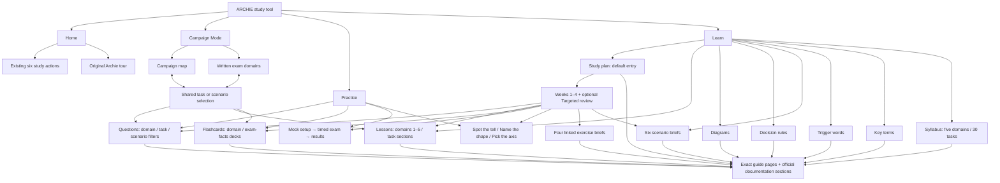

# ARCHIE: approved implementation plan

Status: approved and implemented. The owner authorized execution and publication on main, including the final Trigger Words and Lessons/Diagrams corrections. The original animated proposal remains a design reference; the application is the production implementation.

Final corrections: Trigger Words uses the original three columns (Trigger words, Answer pattern, What to think), recomposed as three labeled fields per row on phones. Lessons present worked decisions with situation, decision, and reasoning. Diagrams provide eight standalone reference models with optional replay, rather than repeating the lesson presentation.

Reading this as a preservation redesign of a gamified exam study app: PS2 strategy-map character, navy/gold identity, fluid and useful interactions. Keep the existing homepage structure and actions. DESIGN_VARIANCE 4, MOTION_INTENSITY 5, VISUAL_DENSITY 3. Taste applies to the homepage and visual consistency; it does not justify replacing the app's working study architecture with a marketing template.

## The direction

The visuals should make the app easier to recognize and navigate, while motion explains a change or confirms an action. A learner should see familiar materials, coherent domain colors, and an immediate response to their input. This is a design hypothesis to validate through use, not a promise of increased retention.

- Remove the cathedral/atlas hero background and the isolated code-gate lesson card.
- Keep Marcellus, Saira, navy, gold, the five domain colors, the original navigation, and the six study actions.
- Keep Archie recognizable and preserve his original sprite, dialogue, hint settings, timing, and 19-step tour. Animate around his existing character, not with a new voice or personality.
- Spend illustration on meaningful objects: task outposts, scenario castles, tools, messages, state, and source documents. Use no decorative hero scene or generated educational text.
- Use the 60:30:10 Show/Tell/Guide split as a communication budget: meaningful visual states and diagrams first; concise factual captions second; optional details and Archie third. Preserve the full question, answer, and lesson content.

## What changes, screen by screen

| Surface | Visual change | Useful motion | Decision effort it removes |
| --- | --- | --- | --- |
| Home | Quiet navy hero, original Archie, six recognizable study objects; keep section order and actions | A short arrival sequence; illustrated objects settle into place; hover/focus/touch uses the same restrained lift; nav selection moves between sections | Mode recognition comes from object + title + one short purpose, not repeated explanation |
| Campaign map | Preserve all regions, coordinates, task IDs, scenarios, fog/progress, and commands; replace crude structures with a coherent crafted sprite set; sharpen terrain and label contrast | A selected outpost settles onto its footprint; only the relevant marker/route reacts; a mastered marker changes state once | Selection and status are visible immediately; geography stays familiar |
| Written exam map | Add `Campaign map / Exam domains` in the same frame; five clearly grouped domains with weights, full task titles, actual progress, and the same task actions | 280-340ms shared transition; preserve the selected task and restore the corresponding marker when returning | Two representations of one dataset, without making the learner find the same task twice |
| Practice and drills | Domain-linked scene symbol, stronger selected/answered states, readable option hierarchy; keep all scenario wording | 160-220ms choice confirmation; 280ms explanation arrival; next question settles without a full-screen jump | Clear confirmation and feedback; no answer hinted by illustration, no automatic next question |
| Flashcards | A real-looking small deck with visible card edges and a stable reading face, using the existing card content and review controls | 320-380ms flip with depth and a reacting shadow; rated card leaves and the next one settles | The stack communicates continuation; front/back state is unmistakable |
| Lessons and diagrams | Replace generic rectangle flowcharts with semantic illustrations and clearly labeled connections; preserve all branches and facts | A diagram demonstrates one meaningful path on entry, then rests; optional controls show alternate conditions; no endless process loop | The mechanism can be understood before the learner operates a control |
| Mock exam and results | Calm exam layout; improve domain report graphics using actual scores | Ambient decoration stops during timed work; score/report changes settle once after submission | Focus while answering; readable domain comparison afterward |

## Campaign map contract

The existing map is the layout source of truth. Do not replace it with an AI painting or reposition its regions. The new sprites fit the existing hit targets and remain subordinate to labels and domain geography. Terrain improvements are shallow texture, clearer depth, restrained shadows, paths and contrast, not a new world composition.

The written representation uses the same `DOM` and `TS` records as the map. Each task has one ID, one selection state, one progress value, and the same practice/lesson/card actions. Presentation preference can be saved separately; existing study storage remains unchanged. Domain order is informational, not an invented prerequisite path.

On mobile, use the existing map's local pan and comfortable targets. Written view stacks the five domain groups with readable full titles. The view switch stays visible and keyboard-operable. Desktop and phone transitions are distinct compositions, not a shrunken desktop animation.

## Learn: a beginning, a route, and sources

### Site map

This is the proposed navigation map. Preserve the four current top-level areas. Exercise briefs are reachable from the itinerary and relevant lessons; they do not add a fifth main area. Both campaign representations lead to the same task actions. Existing preferences, study progress and Archie settings remain app-wide utilities, outside the learning sequence. The journey has a preferred beginning, while every destination remains accessible independently.

Study-loop overlay: **Study-plan step → exact destination → answer/reading/work → Back to the same study-plan step**. External references open separately. There is no required trip through Home or a general setup menu between those points.

Learn opens on **Study plan**. The first useful step is visible immediately; starting a date or configuring a schedule is optional. Keep existing plan checkmarks and start dates. Move the current six-item Fix list after the four weeks as optional **Targeted review**, preserving its IDs and completion state.

Explicit existing actions remain specific: the Home Lessons action opens Lessons; a campaign task's lesson action opens that task's lesson. Only the top-level Learn entry defaults to Study plan.

Tab order: **Study plan → Lessons → Diagrams → Decision rules → Scenarios → Trigger words → Key terms → Syllabus**. At the root, a small illustrated route explains four roles: Begin (Study plan); Understand (Lessons, Diagrams, Decision rules); Apply (Scenarios, Trigger words); Reference (Key terms, Syllabus). These are roles, not locked prerequisites. The first tab is visually strongest; reference tools stay available with less emphasis. On phones the route stacks and the tabs wrap without hiding destinations in another menu.

The study plan becomes an itinerary of linked actions, not a checklist of instructions someone must translate into navigation. Each step contains a specific reading or practice link, supporting guide and official-document links, and its existing manual completion control. Example: **Practice 10 Domain 1 questions** opens the exact domain with a ten-question round ready, while **Read the agentic-loop lesson** opens that lesson and **Scenario 1 questions** opens that scenario. Starting or merely opening a step never marks it completed.

Every destination reached from the plan has **Back to study plan**, restoring the week, step and scroll position. Returning from an external source leaves the app and its progress intact. The learner can still study out of order. Preserve active sessions; navigating to a linked practice set during an unfinished session must offer resume or switch before replacing it.

### Link types and source placement

- **In-app study links:** native hyperlinks to an exact lesson/task, scenario, deck, exercise brief or configured practice set. No generic links to Learn or Practice requiring another search. Cards and practice steps show the domain/scenario and round size in their link text.
- **Exam-guide backlinks:** small labeled references next to the relevant content, such as `Exam guide · Task 1.1 · p. 5`, opening [Task 1.1 in the guide][g5]. Exercise references open [Exercise 1, p. 24][g24], [Exercise 2, p. 25][g25], [Exercise 3, pp. 25–26][g25] or [Exercise 4, p. 26][g26]. Show page and section labels because PDF viewers vary in honoring `#page=`.
- **Official implementation material:** direct documentation pages and existing section anchors beside the step or relevant lesson; for example [the client-tool agent loop][loop], [hook interception][hooks], or [skill frontmatter][skills]. Never substitute a documentation home page, search result or general resource directory.
- **References through the app:** lesson subsections, diagrams, scenario briefs, syllabus task rows, and question explanations link to their underlying guide task and relevant official documentation. Keep a compact inline source line; optionally expand a longer list. Distinguish app-authored explanations from official sample questions. Do not imply every question is an official exam question.

### Destination contract (to implement after approval)

Use hash routes so links survive refresh and work on GitHub Pages without server routing. Route fields come from existing IDs, not displayed labels. Examples: `#learn/lesson?domain=1&task=1.1`, `#practice/questions?domain=1&count=10`, `#practice/questions?scenario=1&count=10`, `#learn/exercise?id=1`, `#learn/plan?week=1&step=p1b`. These are proposed routes; the live app does not support them yet.

Support native link behavior, browser Back/Forward, opening in a new tab, refreshing a destination, and a shareable destination without private progress in the URL. Preserve the plan origin in session state for the return link. Validate IDs/counts and show an available destination if a saved task or filter has no questions. Only start a timed mock after its existing start action. Source links open a new tab with `rel="noopener"`.

Centralize references as a small source registry: source ID, exact URL/anchor or PDF page, title, associated task IDs, guide version, and verification date. Connect plan/lesson/diagram/scenario IDs to these references; render the same records everywhere. Do not hard-code unrelated duplicate resource lists.

### Exact study-step mapping

Keep the four-week structure and all existing completion IDs. Replace vague navigation directions with these specific destinations. Each question target is three explicitly labeled rounds of ten where the current plan calls for 30 questions; repeated practice is allowed and labeled when the bank cannot supply 30 unique items. The existing 70% practice target is a study target, not an official passing-score claim.

| Existing step | Linked in-app destinations | Guide backlink / official material |
| --- | --- | --- |
| p1a · Exam shape and Domain 1 | Exam overview; Domain 1 lessons; Decision rules; Scenario 1 brief | [Exam details, §3 p. 2][g2], [Blueprint and scenarios, §§4–5 p. 3][g3], [Objectives, §6 p. 5 onward][g5]; [agent loop][loop] |
| p1b · Domain 1 practice | Domain 1, rounds 1–3 of 10; answer review | [Domain 1 objectives, pp. 5–8][g5] |
| p1c · Exercise 1 | Exercise 1 brief; lessons 1.1, 1.4, 1.5, 2.2, 5.2; Scenario 1 practice | [Exercise 1, pp. 24–25][g24]; [tool results and errors][results], [hooks][hooks], [tool descriptions][tools] |
| p1d · Flashcards | Exam-facts deck and Domain 1 deck, each directly selected | [Exam details p. 2][g2], [Domain 1 p. 5][g5] |
| p2a · Domains 2 and 3 practice | Separate D2/D3 links, three rounds of 10 for each | [Domain 2 pp. 9–12][g9], [Domain 3 pp. 12–16][g12] |
| p2b · Exercise 2 | Exercise 2 brief; lessons 2.4, 3.1, 3.2, 3.3, 3.4 | [Exercise 2 p. 25][g25]; [path rules][rules], [skill frontmatter][skills], [MCP credentials][mcp-env], [plan workflow][workflow] |
| p2c · Similar tools | Task 2.1 lesson and question set; Scenario 1 questions | [Task 2.1 p. 9][g9]; [tool descriptions][tools] |
| p2d · Trigger recognition | Trigger-word drill configured for 10; original trigger glossary | [Objectives §6 p. 5 onward][g5]; guide-task backlinks beside each applicable trigger, labeled as an app study aid |
| p3a · Domains 4 and 5 practice | Separate D4/D5 links, three rounds of 10 for each | [Domain 4 pp. 16–19][g16], [Domain 5 pp. 19–23][g19] |
| p3b · Exercise 3 | Exercise 3 brief; lessons 4.3, 4.4, 4.5, 5.5; Scenario 6 questions | [Exercise 3 pp. 25–26][g25]; [schema behavior][schema], [batch results][batch] |
| p3c · Exercise 4 | Exercise 4 brief; lessons 1.2, 1.3, 5.3, 5.6; Scenario 3 questions | [Exercise 4 p. 26][g26]; [subagent invocation][subagents], [context management][context] |
| p3d · Distractor recognition | Wrong-answer-shape drill and the five-shape reference | [Sample questions pp. 27–33][g27]; each explanation's applicable task reference; label the taxonomy as an app study aid |
| p4a · Two mock exams | Mock setup; first/second run; saved results review | [Exam format p. 2][g2]; no automatic timer start |
| p4b · Weak tasks | Dynamic direct links for actual weak task IDs to question set, lesson and campaign marker | Corresponding task page in §6; no instruction to hunt for a Home heatmap |
| p4c · Final review | Ten decision rules; five distractor shapes; missed-answer review | [Objectives §6 p. 5][g5], [samples §9 p. 27][g27]; specific per-rule sources |
| p4d · Exam setup | Source-linked readiness checklist | [Registration §11 pp. 33–34][g33], [policies §12 p. 34][g34], [exam-day rules §13 p. 35][g35]; no new account or appointment facts invented |
| f1 · Skills review | Level 3 lesson; exact key-term entries for relevant skill fields | [Task 3.2 p. 13][g13]; [frontmatter][skills], [tool restrictions][skill-tools], [isolated skill execution][skill-fork] |
| f2 · Permission versus isolation | The applicable Level 3 comparison and diagram | [Task 3.2 p. 13][g13]; [frontmatter][skills], [isolated skill execution][skill-fork] |
| f3 · Skills self-check | Exact Level 3 self-check section and Task 3.2 question set | [Task 3.2 p. 13][g13]; [tool restrictions][skill-tools] |
| f4 · Retry sorting | Extraction-error drill; Task 4.4 lesson | [Task 4.4 p. 18][g18]; [tool error handling][results], [MCP errors][mcp-errors] |
| f5 · Configuration and retries | Exact mechanism drill; Tasks 3.2 and 4.4 practice links | [Task 3.2 p. 13][g13], [Task 4.4 p. 18][g18]; [frontmatter][skills] |
| f6 · Axis comparison | Mechanism-pair drill and explanatory reference | Per-pair task references; this is an app strategy, not an official guide section |

For p1a, `sections 3–6` means named **guide sections**, not pages 3–6 or a nonexistent sixth domain. Present an expandable reading list with separate links and a visible `All domain objectives` reference rather than implying the entire objectives section is a short introductory read. There are five domains. Add an anchored overview in the app for immediate orientation while retaining the primary guide reference.

Exercise briefs provide the guide's goal, the applicable task links and a completion checklist. They are hands-on work performed by the learner in their own development environment, not a fake in-browser agent builder. Clearly separate the official exercise from app practice recommendations.

### Link and journey acceptance checks

From a fresh browser, Learn opens Study plan; the first week requires no setup. Every existing plan item has a specific working internal destination or direct official resource. D1 practice opens D1 with count 10; scenario links retain scenario filters; lesson links select the correct domain/task; exercise links open the correct brief. No link silently clears an active exam/session or changes completion state.

Test refresh, Back/Forward, new-tab destinations, returning to the originating plan item, saved completion IDs, keyboard/touch links, mobile wrapping, and link text. Verify all 30 task guide pages and all four exercise references. Check HTTP redirects and actual anchor IDs; a 200 response alone does not prove the destination is correct. Store the guide version (1.0, effective July 2026) and verification date (2026-10-12). If current official docs have evolved beyond the guide, preserve the exam scope and label the newer implementation reference.

[g2]: https://everpath-course-content.s3-accelerate.amazonaws.com/instructor%2F6nizmqk8tpzpfjvt6qmmav7rh%2Fpublic%2F1783542750%2FClaude+Certified+Architect+%E2%80%93+Foundations+Exam+Guide.pdf#page=2
[g3]: https://everpath-course-content.s3-accelerate.amazonaws.com/instructor%2F6nizmqk8tpzpfjvt6qmmav7rh%2Fpublic%2F1783542750%2FClaude+Certified+Architect+%E2%80%93+Foundations+Exam+Guide.pdf#page=3
[g5]: https://everpath-course-content.s3-accelerate.amazonaws.com/instructor%2F6nizmqk8tpzpfjvt6qmmav7rh%2Fpublic%2F1783542750%2FClaude+Certified+Architect+%E2%80%93+Foundations+Exam+Guide.pdf#page=5
[g9]: https://everpath-course-content.s3-accelerate.amazonaws.com/instructor%2F6nizmqk8tpzpfjvt6qmmav7rh%2Fpublic%2F1783542750%2FClaude+Certified+Architect+%E2%80%93+Foundations+Exam+Guide.pdf#page=9
[g12]: https://everpath-course-content.s3-accelerate.amazonaws.com/instructor%2F6nizmqk8tpzpfjvt6qmmav7rh%2Fpublic%2F1783542750%2FClaude+Certified+Architect+%E2%80%93+Foundations+Exam+Guide.pdf#page=12
[g13]: https://everpath-course-content.s3-accelerate.amazonaws.com/instructor%2F6nizmqk8tpzpfjvt6qmmav7rh%2Fpublic%2F1783542750%2FClaude+Certified+Architect+%E2%80%93+Foundations+Exam+Guide.pdf#page=13
[g16]: https://everpath-course-content.s3-accelerate.amazonaws.com/instructor%2F6nizmqk8tpzpfjvt6qmmav7rh%2Fpublic%2F1783542750%2FClaude+Certified+Architect+%E2%80%93+Foundations+Exam+Guide.pdf#page=16
[g18]: https://everpath-course-content.s3-accelerate.amazonaws.com/instructor%2F6nizmqk8tpzpfjvt6qmmav7rh%2Fpublic%2F1783542750%2FClaude+Certified+Architect+%E2%80%93+Foundations+Exam+Guide.pdf#page=18
[g19]: https://everpath-course-content.s3-accelerate.amazonaws.com/instructor%2F6nizmqk8tpzpfjvt6qmmav7rh%2Fpublic%2F1783542750%2FClaude+Certified+Architect+%E2%80%93+Foundations+Exam+Guide.pdf#page=19
[g24]: https://everpath-course-content.s3-accelerate.amazonaws.com/instructor%2F6nizmqk8tpzpfjvt6qmmav7rh%2Fpublic%2F1783542750%2FClaude+Certified+Architect+%E2%80%93+Foundations+Exam+Guide.pdf#page=24
[g25]: https://everpath-course-content.s3-accelerate.amazonaws.com/instructor%2F6nizmqk8tpzpfjvt6qmmav7rh%2Fpublic%2F1783542750%2FClaude+Certified+Architect+%E2%80%93+Foundations+Exam+Guide.pdf#page=25
[g26]: https://everpath-course-content.s3-accelerate.amazonaws.com/instructor%2F6nizmqk8tpzpfjvt6qmmav7rh%2Fpublic%2F1783542750%2FClaude+Certified+Architect+%E2%80%93+Foundations+Exam+Guide.pdf#page=26
[g27]: https://everpath-course-content.s3-accelerate.amazonaws.com/instructor%2F6nizmqk8tpzpfjvt6qmmav7rh%2Fpublic%2F1783542750%2FClaude+Certified+Architect+%E2%80%93+Foundations+Exam+Guide.pdf#page=27
[g33]: https://everpath-course-content.s3-accelerate.amazonaws.com/instructor%2F6nizmqk8tpzpfjvt6qmmav7rh%2Fpublic%2F1783542750%2FClaude+Certified+Architect+%E2%80%93+Foundations+Exam+Guide.pdf#page=33
[g34]: https://everpath-course-content.s3-accelerate.amazonaws.com/instructor%2F6nizmqk8tpzpfjvt6qmmav7rh%2Fpublic%2F1783542750%2FClaude+Certified+Architect+%E2%80%93+Foundations+Exam+Guide.pdf#page=34
[g35]: https://everpath-course-content.s3-accelerate.amazonaws.com/instructor%2F6nizmqk8tpzpfjvt6qmmav7rh%2Fpublic%2F1783542750%2FClaude+Certified+Architect+%E2%80%93+Foundations+Exam+Guide.pdf#page=35
[loop]: https://platform.claude.com/docs/en/agents-and-tools/tool-use/how-tool-use-works#the-agentic-loop-client-tools
[results]: https://platform.claude.com/docs/en/agents-and-tools/tool-use/handle-tool-calls#handling-errors-with-is-error
[hooks]: https://code.claude.com/docs/en/agent-sdk/hooks#add-context-and-block-a-tool
[tools]: https://platform.claude.com/docs/en/agents-and-tools/tool-use/define-tools
[rules]: https://code.claude.com/docs/en/memory#path-specific-rules
[skills]: https://code.claude.com/docs/en/skills#frontmatter-reference
[skill-tools]: https://code.claude.com/docs/en/skills#pre-approve-tools-for-a-skill
[skill-fork]: https://code.claude.com/docs/en/skills#run-skills-in-a-subagent
[mcp-env]: https://code.claude.com/docs/en/mcp#environment-variable-expansion-in-mcp-json
[workflow]: https://code.claude.com/docs/en/best-practices#explore-first-then-plan-then-code
[schema]: https://platform.claude.com/docs/en/build-with-claude/structured-outputs
[batch]: https://platform.claude.com/docs/en/build-with-claude/batch-processing#retrieving-batch-results
[subagents]: https://code.claude.com/docs/en/agent-sdk/subagents#invoke-subagents
[context]: https://platform.claude.com/docs/en/build-with-claude/context-windows#manage-context-with-compaction
[mcp-errors]: https://modelcontextprotocol.io/specification/2025-06-18/server/tools#error-handling

## Motion specification

Motion personality: steady professional UI with a small amount of game character. Signature easing: `cubic-bezier(.2,0,0,1)`. No exaggerated elastic springs.

| Event | Duration | Primary / secondary / ambient |
| --- | --- | --- |
| Hover, focus, press | 120-180ms | Object moves 2-3px / shadow responds / no ambient addition |
| Selection and section change | 260-340ms | Selection or content moves / focus and contrast settle / original Archie remains alive |
| Flashcard flip | 320-380ms | Card rotates / shadow and deck settle / background stays quiet |
| Diagram example | 1.2-1.8s total, one pass | A token follows a real path / current node acknowledges / no competing animation |
| Result or mastery update | 400-600ms | Actual value transitions / marker settles / no confetti or escalating reward loop |

At most one-third of visible elements move together. Entrance staggering stays below 500ms. Keep normal reading surfaces still. Pause offscreen/hidden motion. Provide Pause motion for persistent decorative movement and fully respect reduced motion. Mobile uses tap/focus feedback; no hover-only information, cursor effects, scroll hijacking, autoplay audio, or motion required to understand a fact.

The animated approval preview demonstrates navigation/content transitions, a map/written switch, answer feedback, a card flip, and one animated agent-loop example. Preview study actions are illustrative and do not save to the live app.

## Art production

Higgsfield created two coherent sample sheets and a subtle terrain material for this proposal: crafted campaign sprites and semantic learning symbols. Use their silhouettes and material treatment as the direction. Before production, finish transparent edges and separate moving layers where necessary; judge sprites at their actual 40-80px display sizes, not just at source resolution. Existing mode art can be refined into the same family instead of replaced indiscriminately.

No model-generated labels, numbers, task titles, arrows, facts, or option text. Those remain semantic UI sourced from the application's guide data. Use optimized WebP/AVIF or transparent PNG/WebP only as needed. No hero video or WebGL is justified here.

## Source of truth and validation

Downloaded Anthropic's original CCAR-F guide from the public Partner Academy CDN, 39 pages. Confirmed all 30 task IDs, task titles (normalizing PDF line-wrap hyphens), and the domain weights 27/18/20/20/15 against the repository. The exam guide, not the game theme, defines the curriculum. Source: https://everpath-course-content.s3-accelerate.amazonaws.com/instructor%2F6nizmqk8tpzpfjvt6qmmav7rh%2Fpublic%2F1783542750%2FClaude+Certified+Architect+%E2%80%93+Foundations+Exam+Guide.pdf

Reference principles: readable objects and terrain from the official Age of Empires remaster gallery, without copying its assets or composition: https://www.ageofempires.com/news/visual-look-at-aoe2de/

After approval: implement one shared art/motion system in the current vanilla app; use CSS/Web Animations first and add a library only if a required transition needs it. Verify question/card data unchanged, original Archie source/settings unchanged, full practice/drills/mock/tour flows, 30 tasks in both map views, shared selection/progress, browser storage, keyboard/touch focus, reduced motion, and mobile overflow. Review actual rendered movement, not just screenshots. Verify performance and the final deployed GitHub Pages URL.

Approval covers the direction and motion shown in the preview, the campaign/written toggle, the linked study journey, site map, source references, and the final corrections above. Production checks cover the original functional suite, five responsive profiles, deep links and return paths, keyboard access, motion pause and reduced motion, original content and Archie preservation, and the deployed GitHub Pages URL.
